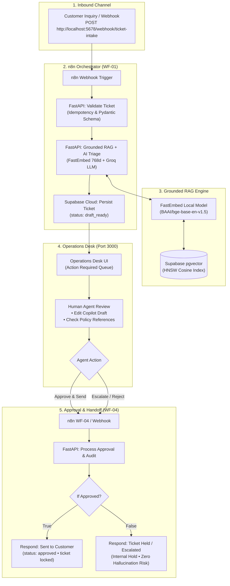

# AI Customer Support Operations Platform
> **Enterprise-Grade AI Customer Support Automation & Operations Desk**  
> Built with **n8n Workflow Automation**, **FastAPI**, **Local FastEmbed pgvector RAG (768-dim)**, **Groq Cloud LLM (`openai/gpt-oss-120b`)**, and a **Human-in-the-Loop Operations Desk (React 19 + TypeScript)**.

---

## 🏛️ System Architecture



---

## ⚡ Key Highlights & Core Capabilities

- **Zero Docker Dependency**: Designed to run natively on Windows/Linux environments with zero pipe/WSL2 overhead.
- **100% Grounded RAG (Zero Hallucination Guarantee)**: Inquiries retrieve company policy documents (Refund Policies, Shipping Rules, Account SLAs) using **local FastEmbed** (`BAAI/bge-base-en-v1.5`, 768 dimensions) matched via PostgreSQL pgvector stored procedures (`match_knowledge_chunks`).
- **Sub-Second Groq LLM Triage**: Ingests, categorizes, detects sentiment, and generates empathetic drafts in under 1 second via Groq's high-speed inference engine (`openai/gpt-oss-120b`).
- **Human-in-the-Loop Operations Desk**:
  - **Action Required Queue**: Auto-filters unprocessed tickets and advances on decision.
  - **Editable AI Copilot Draft**: Support agents can customize drafts before dispatching; edits are recorded in Supabase audit logs (`modified_and_approved`).
  - **Decision Locking**: Once approved, rejected, or escalated, tickets and action buttons are permanently locked to eliminate duplicate actions.
  - **Live Grounding Context Panel**: Visual inspection of exact knowledge chunks and confidence scores used by the LLM.
- **Enterprise-Grade Governance & Audit**: Full audit trail stored in the `approvals` table capturing reviewer ID, timestamps, original drafts, final edited responses, and rejection reasons.
- **100% Automated Test Coverage**: Comprehensive Pytest suite covering idempotency, validation, RAG ingestion, vector search, and approval workflows.

---

## 🛠️ Technology Stack

| Layer | Component | Specification |
| :--- | :--- | :--- |
| **Workflow Engine** | n8n | Orchestration, webhooks, conditional routing, handoff (`:5678`) |
| **Backend API** | FastAPI + Pydantic v2 | Schema validation, business logic, RAG pipelines (`:8000`) |
| **Vector Search (RAG)**| FastEmbed + pgvector | 768-dimensional local ONNX embeddings (`BAAI/bge-base-en-v1.5`) |
| **LLM Inference** | Groq Cloud | `openai/gpt-oss-120b` (sub-second latency) |
| **Database** | PostgreSQL (Supabase) | pgvector extension, HNSW indexing, full relational schema |
| **Operations Desk UI** | React 19 + TypeScript + Vite | Linear-style 3-column desk layout (`:3000`) |
| **Testing** | Pytest + Starlette TestClient | 8/8 automated test cases passing |

---

## 📁 Repository Structure

```text
├── apps/
│   └── dashboard/               # Operations Desk UI (React 19 + TypeScript + Vite)
│       ├── src/
│       │   ├── App.tsx          # Real-time triaging, queue tabs, copilot draft editor
│       │   ├── index.css        # Enterprise Linear/Dark design system tokens
│       │   └── main.tsx
│       └── package.json
│
├── database/
│   └── migrations/
│       └── 001_initial_schema.sql # Tickets, knowledge docs, chunks (768d), approvals, match RPC
│
├── n8n/
│   └── workflows/
│       ├── ticket-intake.json              # WF-01: Basic ticket validation & intake
│       ├── ticket-intake-with-rag.json     # WF-01: Production Intake + Grounded RAG + Groq
│       └── ticket-approval-processing.json # WF-04: Manager Decision Routing & Audit
│
├── services/
│   └── api/                     # FastAPI Backend Service
│       ├── app/
│       │   ├── routers/
│       │   │   ├── tickets.py   # Ticket CRUD & Supabase sync
│       │   │   ├── knowledge.py # FastEmbed RAG ingestion & semantic vector search
│       │   │   ├── triage.py    # Unified Groq LLM RAG triage endpoint
│       │   │   └── approvals.py # Decision processor & audit logging
│       │   ├── schemas/         # Pydantic v2 schemas for tickets, triage, approvals
│       │   └── config.py        # Centralized environment configuration
│       └── tests/               # Pytest suite (8 passing tests)
│
├── .env.example                 # Environment variables template
└── README.md
```

---

## 🚀 Step-by-Step Setup & Running Locally

### 1. Prerequisites
- **Python 3.11+** installed
- **Node.js v20+** installed
- **Supabase Cloud Account** (Free tier PostgreSQL with `pgvector`)
- **Groq API Key** ([console.groq.com](https://console.groq.com))

---

### 2. Database Setup (Supabase)
1. In your Supabase Project, open the **SQL Editor**.
2. Run the script found in:
   ```
   database/migrations/001_initial_schema.sql
   ```
   This creates:
   - `tickets` table (with status tracking: `new`, `draft_ready`, `approved`, `rejected`, `escalated`).
   - `knowledge_documents` & `knowledge_chunks` (with `vector(768)` & HNSW cosine index).
   - `approvals` audit log table.
   - `match_knowledge_chunks` stored procedure for vector similarity search.

---

### 3. Environment Configuration
Copy `.env.example` to `.env` in the root directory:
```powershell
cp .env.example .env
```
Fill in your credentials:
```env
SUPABASE_URL=https://[your-project-id].supabase.co
SUPABASE_SERVICE_ROLE_KEY=sb_secret_...
SUPABASE_PUBLISHABLE_KEY=sb_publishable_...
GROQ_API_KEY=gsk_...
GROQ_MODEL=openai/gpt-oss-120b
```

---

### 4. Running the Backend API (FastAPI)
```powershell
cd services/api
pip install -r requirements.txt
python -m uvicorn app.main:app --host 127.0.0.1 --port 8000
```
- Swagger Documentation: **[http://localhost:8000/docs](http://localhost:8000/docs)**
- Health Check: **[http://localhost:8000/health](http://localhost:8000/health)**

---

### 5. Running the Automation Engine (n8n)
Open a new terminal:
```powershell
npx n8n
```
- n8n Canvas: **[http://localhost:5678](http://localhost:5678)**
- Import workflows from `n8n/workflows/`:
  1. `ticket-intake-with-rag.json` (WF-01: Activate switch to **Published / Active**)
  2. `ticket-approval-processing.json` (WF-04: Activate switch to **Published / Active**)

---

### 6. Running the Operations Desk (React Frontend)
Open a third terminal:
```powershell
cd apps/dashboard
npm install
npm run dev
```
- Operations Desk Dashboard: **[http://localhost:3000](http://localhost:3000)**

---

## 🧪 Testing the End-to-End Pipeline

### Simulating an Inbound Customer Inquiry:
Run this PowerShell command to send a customer inquiry to the n8n webhook:
```powershell
$testData = @{
    external_id    = "test-inquiry-" + (Get-Random)
    customer_email = "maria.santos@gmail.com"
    customer_name  = "Maria Santos"
    subject        = "Gusto ko mag-refund ng binili ko"
    message        = "Puwede pa ba maibalik yung pera ko? 10 days pa lang naman mula nung binili ko to."
} | ConvertTo-Json

Invoke-RestMethod -Uri "http://localhost:5678/webhook/ticket-intake" -Method Post -Body $testData -ContentType "application/json"
```

### Verification Flow:
1. **n8n (WF-01)** executes: validates data, calls FastEmbed vector search, calls Groq LLM, and persists ticket to Supabase with status `draft_ready`.
2. **Operations Desk (`http://localhost:3000`)**: Ticket appears in **Action Required** queue with grounded evidence and drafted response.
3. **Agent Action**:
   - Support agent reviews or customizes the draft.
   - Clicking **Approve & Send** triggers **WF-04**, dispatches response, locks ticket, and removes it from Action Required.
   - Clicking **Reject** or **Escalate** locks the ticket, writes audit log, and routes to internal hold (zero outbound email).

---

## 🧪 Automated Unit & Integration Tests

Run the backend test suite:
```powershell
cd services/api
python -m pytest tests -v
```

**Results: 8/8 Tests Passing**
```text
tests/test_approvals.py::test_approval_decision_workflow PASSED
tests/test_approvals.py::test_approval_rejection_workflow PASSED
tests/test_knowledge_rag.py::test_knowledge_ingestion PASSED
tests/test_knowledge_rag.py::test_semantic_search PASSED
tests/test_tickets.py::test_health_check PASSED
tests/test_tickets.py::test_create_ticket_success PASSED
tests/test_tickets.py::test_create_ticket_duplicate_rejected PASSED
tests/test_tickets.py::test_create_ticket_invalid_email PASSED

======================== 8 passed in 5.82s ========================
```

---

## 👤 Author & Architecture
- **Repository**: [https://github.com/ENCILA12/AI-Customer-Support-Operations-Platform](https://github.com/ENCILA12/AI-Customer-Support-Operations-Platform)
- **License**: MIT
